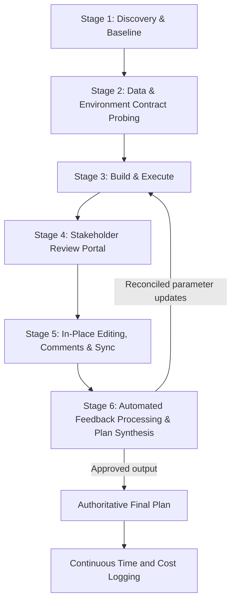
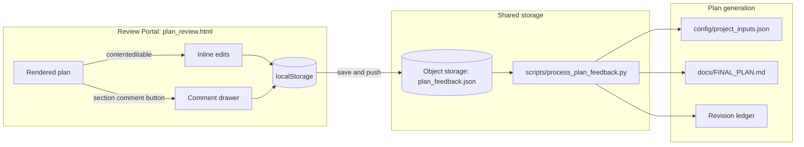

# The AI-Driven Development Playbook: Plan Formulation, Stakeholder Review & Time/Cost Tracking

**A reusable blueprint for any AI-assisted project: interview first, record decisions as data, review collaboratively, and account for every hour and every dollar.**
*Repository Reference:* [GetBack2Basics Playbooks](https://github.com/GetBack2Basics/CheatSheets)
*Applies to:* software, data, GIS, infrastructure, content, or research projects where an AI agent does meaningful work alongside human stakeholders.
*Companion playbook:* [`ai_anti_mock_hallucination_playbook.md`](ai_anti_mock_hallucination_playbook.md) (data integrity gates).

> **How AI agents should use this document.** When a project references this playbook, the agent must (1) run the Section 0 intake interview before doing work, (2) store every answer in the project's machine-readable config, (3) log time and cost for each work session, and (4) route stakeholder feedback through the review loop in Sections 3-4 instead of editing documents by hand. Everything in angle brackets (`<project>`, `<bucket>`) is a placeholder to be filled from the interview, never assumed.

---

## 0. Start Here: The AI Intake Interview (Mandatory Before Any Work)

**This playbook is generic; your project is not.** Skipping the interview is the root cause of wrong assumptions, unviable plans, and documentation that drifts from reality.

### 0.1 Rules for the interview

1. **Discover before asking.** Inspect the repository first (`config/`, `docs/`, `scripts/`, `README.md`, time/cost log, issue tracker). State what you inferred so the user can confirm or correct it.
2. **Ask domain-specific questions, not platitudes.** Tailor questions to the project's actual goals, constraints and stakeholders.
3. **Offer concrete options with a recommended default.** Ask in small batches (3-5 questions) with rationale.
4. **Re-interview when parameters drift.** If a review call changes a target, threshold or scope, update config first, not just chat.
5. **Record invariants in machine-readable config.** Answers go into a config file immediately (see 0.3). Never keep planning parameters only in conversation context.
6. **State consequences before heavy work.** Before long compute, cloud deployments or large refactors, declare the expected duration and resources used.

### 0.2 Question bank (modular blocks)

**Block A: Goals, scope & success criteria**
- What is the outcome, who is the end user, and what does "done" look like (measurable acceptance criteria)?
- What are the hard constraints (deadline, platform, compliance, budget ceiling, tech stack)?
- What is explicitly out of scope?

**Block B: Domain parameters & invariants**
- Which numeric targets, thresholds or rules drive the plan, and which are fixed vs tunable?
- What authoritative data sources, standards or specifications are binding?
- What failure modes are unacceptable (data loss, synthetic fallbacks, silent approximations)?

**Block C: Stakeholders & governance**
- Who reviews, who approves, and who is informed? What organisations do they belong to?
- What decision cadence applies (review calls, sign-off gates, escalation triggers)?
- How are directives recorded and how is conflict between stakeholders resolved?

**Block D: Collaborative review portal**
- Should stakeholders edit plan text, parameters and tables in place (`contenteditable`)?
- Do they need in-line comments on sections with structured statuses (`PENDING`, `REVIEWED`, `IMPLEMENTED`, `REJECTED`)?
- Where should feedback persist (browser `localStorage`, cloud object storage, a database)?
- **Visual design:** unless a brand style is specified, propose the "Mobile Review Portal" template in Section 4.

**Block E: Time & cost accounting**
- Which actors must be tracked (humans, AI sessions, cloud compute, managed services)?
- Is the log measured in time only, or time plus currency? What rates and currency apply?
- Is there a baseline budget in hours or dollars to reconcile against, and who owns it?
- What ID formats apply (`LOG-001`, `REV-001`, `CMT-001`)?

### 0.3 Invariant recording: the master config

Materialize interview answers into a config file such as `config/project_inputs.json`. Example skeleton (replace the domain block with your project's parameters):

```json
{
  "project_metadata": {
    "project_name": "<project>",
    "status": "draft | approved_final_plan",
    "updated_at": "<ISO-8601>"
  },
  "domain_parameters": {
    "<parameter_name>": "<value>",
    "<another_parameter>": "<value>"
  },
  "governance_and_tracking": {
    "time_cost_log_path": "TIME_AND_COST_LOG.md",
    "feedback_json_path": "data/feedback/plan_feedback.json",
    "final_plan_markdown_path": "docs/FINAL_PLAN.md",
    "enable_inline_edits": true,
    "enable_section_comments": true,
    "currency": "<ISO 4217 code or null for time-only>"
  }
}
```

---

## 1. The Plan Formulation Lifecycle



| Stage | What happens | Outputs |
|---|---|---|
| **1. Discovery & baseline** | Run the intake interview; capture goals, constraints, stakeholders; commit baseline parameters to version control. | Master config; baseline plan |
| **2. Contract probing** | Verify upstream data/APIs/environments match assumptions (schemas, types, record counts, coordinate or unit systems, auth). | Probe report; recorded contracts |
| **3. Build & execute** | Implement and run the work. Declare expected runtime/resources before heavy runs. Log every session. | Code, data, deployments |
| **4. Review portal** | Deliver a single-file, shareable review page (Section 4) so non-technical stakeholders can read, edit and comment. | `plan_review.html` |
| **5. Edit, comment & sync** | Capture edits and comments locally, then sync to shared storage. | Feedback JSON |
| **6. Feedback processing** | Ingest meeting notes and portal feedback, reconcile parameter changes into config, regenerate the final plan with a revision ledger. | Final plan; revision ledger |

---

## 2. Time & Cost Tracking Standard

Every pipeline run, AI session, review meeting and cloud job must be logged. Unlogged work is invisible budget burn.

### 2.1 Resource taxonomy

| Tier | Resource | Typical activities | Metric tracked |
|---|---|---|---|
| **1. Human** | Engineer, analyst, project lead | Architecture, review meetings, sign-off, problem solving | Hours (e.g. `2.50 hrs`) |
| **2. AI agent** | LLM/agent sessions | Code generation, refactoring, lint, document synthesis | Session duration (e.g. `12 mins`); optional token/credit cost |
| **3. Cloud compute** | VMs, containers, batch jobs | Long-running services, routing, ETL, builds | Active runtime (e.g. `45s`, `0.05 hrs`) |
| **4. Managed services** | Warehouses, distributed engines, storage | Query jobs, cluster runs, persistent storage | Job duration or metered usage |

Pick one policy during the interview and record it in config:
- **Pure time standard** (default): log durations only; no currency.
- **Time plus cost**: add a unit rate and estimated cost column; keep a rate card (below) and distinguish *real metered cost* from *conversational estimates*.

### 2.2 `TIME_AND_COST_LOG.md` structure

1. **Budget summary dashboard**: per workstream, baseline hours, logged actuals, remaining hours, machine duration/cost, and status (`SCHEDULED`, `IN PROGRESS`, `COMPLETED`, `ON TRACK`, `AT RISK`).
2. **Granular event ledger**: one row per event.

   | Entry ID | Date / Time | Phase | Actor / Resource | Activity / Task | Duration | Resource Type | Unit Rate (optional) | Est. Cost (optional) | Artifacts |
   |---|---|---|---|---|---|---|---|---|---|

   - `Entry ID`: sequential (`LOG-001`, `LOG-002`, ...). `Resource Type`: `Human Time`, `AI Machine Time`, `Cloud Compute Time`, `Managed Service`.
   - `Artifacts`: links to the files, data or reports produced.
3. **Cost breakdown (if tracking currency)**: rate card (region, machine/service SKU, unit price), per-run cost formula, and cumulative real cost to date. Include a worst-case ceiling (for example, 24/7 uptime) so stakeholders see the upper bound.
4. **Logging protocol and actor definitions**: explicit definitions of each actor class so entries are unambiguous.

> **Real vs estimated.** Label conversational figures ("about \$15 for the run") as estimates and never mix them with metered actuals. Reconcile the two in the dashboard.

### 2.3 Revision & scope evolution ledger

To prevent parameter drift and preserve decision provenance, maintain a chronological ledger (`chronological_revisions` in the feedback JSON and a section of the final plan):

| Rev # | Date | Milestone / Source Event | Stakeholders (A-Z by surname) | Key directives & refinements | Machine run | AI revisions | Human time | Status |
|---|---|---|---|---|---|---|---|---|
| **REV-001** | `<date>` | Inception meeting | `<names>` | Baseline brief and targets | None | Initial scaffolding | `<hrs>` | Approved |
| **REV-00N** | `<date>` | `<review event>` | `<names>` | `<what changed and why>` | `<run id>` | `<AI work>` | `<hrs>` | Approved / Superseded |

Statuses: `Approved`, `Implemented`, `Superseded`. Sort stakeholders by surname for consistent attribution.

### 2.4 Recipe: automated time logger

```python
"""
scripts/log_time_entry.py
Appends structured entries to TIME_AND_COST_LOG.md across Human, AI, and Cloud actors.
"""
import datetime
import re
from pathlib import Path

LOG_FILE = Path("TIME_AND_COST_LOG.md")
MARKER = "| Entry ID | Date / Time | Phase | Actor / Resource | Activity / Task | Duration | Resource Type | Artifacts |"

def next_log_id(content: str) -> str:
    ids = [int(m) for m in re.findall(r"LOG-(\d+)", content)]
    return f"LOG-{(max(ids) + 1) if ids else 1:03d}"

def log_entry(actor, hours, phase, activity, artifacts, resource_type="Human Time"):
    if not LOG_FILE.exists():
        raise FileNotFoundError(f"Missing {LOG_FILE}")
    content = LOG_FILE.read_text(encoding="utf-8")
    if MARKER not in content:
        raise ValueError("Ledger header not found; align MARKER with your log table.")
    entry_id = next_log_id(content)
    now = datetime.datetime.now().strftime("%Y-%m-%d %H:%M")
    mins = int(round(hours * 60))
    row = f"| **{entry_id}** | {now} | {phase} | {actor} | {activity} | {mins} mins ({hours:.2f} hrs) | {resource_type} | {artifacts} |\n"
    head, tail = content.split(MARKER, 1)
    sep_end = tail.index("\n") + 1          # end of header line
    sep_end = tail.index("\n", sep_end) + 1  # end of separator line
    LOG_FILE.write_text(head + MARKER + tail[:sep_end] + row + tail[sep_end:], encoding="utf-8")
    print(f"[OK] {entry_id}: {hours:.2f} hrs by {actor}")

if __name__ == "__main__":
    log_entry("AI Assistant", 0.25, "Governance", "Configured review portal and feedback sync",
              "plan_review.html, scripts/process_plan_feedback.py", "AI Machine Time")
```

---

## 3. In-Situ Collaborative Plan Review Architecture



### 3.1 Edit-in-place pattern
Stakeholders suggest changes in chat, forcing engineers to hand-edit documents. Remove that friction:
1. **Keyed elements**: every editable element carries a stable `data-edit-key`.
2. **Edit mode toggle**: off by default (preview mode); a top bar toggles `contenteditable` and shows an edit counter.
3. **Change highlighting**: edited elements get a visible marker (for example an amber border) to distinguish proposals from baseline.
4. **Undo**: per-element revert plus a global "reset all edits".

### 3.2 In-line contextual comments
Each major heading has a comment trigger that opens a drawer pre-filled with the section. Each comment records:
- `id` (`CMT-001`...), `author`, `organization`, `section_title`, `comment`, `timestamp`
- `status`: `PENDING` until the change is implemented, then `IMPLEMENTED` (or `REVIEWED` / `REJECTED`)

### 3.3 Recipe: edit and comment client (JavaScript)

```javascript
let editModeActive = false;
const EDITS_KEY = "<PROJECT>_PLAN_INLINE_EDITS";
const FEEDBACK_KEY = "<PROJECT>_PLAN_FEEDBACK";

function toggleEditMode() {
  editModeActive = !editModeActive;
  document.querySelectorAll("[data-edit-key]").forEach(el => {
    el.contentEditable = editModeActive ? "true" : "false";
    el.classList.toggle("editable-active", editModeActive);
    el.onblur = editModeActive ? () => saveElementEdit(el) : null;
  });
}

function saveElementEdit(el) {
  const edits = JSON.parse(localStorage.getItem(EDITS_KEY) || "{}");
  edits[el.dataset.editKey] = { html: el.innerHTML.trim(), updated_at: new Date().toISOString() };
  localStorage.setItem(EDITS_KEY, JSON.stringify(edits));
  el.classList.add("element-modified");
}

function addSectionComment(sectionTitle, author, text) {
  const data = JSON.parse(localStorage.getItem(FEEDBACK_KEY) || '{"comments":[]}');
  const id = `CMT-${String(data.comments.length + 1).padStart(3, "0")}`;
  data.comments.push({ id, author, section_title: sectionTitle, comment: text,
                       timestamp: new Date().toISOString(), status: "PENDING" });
  localStorage.setItem(FEEDBACK_KEY, JSON.stringify(data));
  return id;
}

async function syncFeedbackToCloud(endpointUrl) {
  const payload = {
    inline_edits: JSON.parse(localStorage.getItem(EDITS_KEY) || "{}"),
    feedback: JSON.parse(localStorage.getItem(FEEDBACK_KEY) || "{}"),
    synced_at: new Date().toISOString()
  };
  const res = await fetch(endpointUrl, {
    method: "PUT", headers: { "Content-Type": "application/json" },
    body: JSON.stringify(payload, null, 2)
  });
  if (!res.ok) throw new Error(`Sync failed: ${res.status}`);
}
```

### 3.4 Recipe: feedback synthesis runner (Python)

```python
"""
scripts/process_plan_feedback.py
Reconciles feedback, updates config, and compiles the authoritative plan with a revision ledger.
"""
import json
from datetime import datetime
from pathlib import Path

CONFIG = Path("config/project_inputs.json")
FEEDBACK = Path("data/feedback/plan_feedback.json")
PLAN_MD = Path("docs/FINAL_PLAN.md")

def reconcile_and_compile():
    config = json.loads(CONFIG.read_text(encoding="utf-8"))
    feedback = json.loads(FEEDBACK.read_text(encoding="utf-8"))
    params = config.get("domain_parameters", {})
    comments = feedback.get("comments", [])
    revisions = feedback.get("chronological_revisions", [])

    lines = [
        f"# {config['project_metadata']['project_name']}: Final Plan", "",
        f"**Reconciled:** {datetime.now():%d %b %Y, %H:%M}  ", "", "---", "",
        "## 1. Authoritative Parameters", "",
        "| Parameter | Approved Value |", "|---|---|",
        *[f"| **{k}** | {v} |" for k, v in params.items()], "",
        "## 2. Stakeholder Feedback & Resolution", "",
        "| ID | Author | Section | Feedback | Status |", "|---|---|---|---|---|",
        *[f"| **{c.get('id')}** | {c.get('author')} | {c.get('section_title')} | "
          f"{c.get('comment')} | `{c.get('status', 'PENDING')}` |" for c in comments], "",
        "## 3. Revision History Ledger", "",
        "| Rev # | Date | Source | Summary | Status |", "|---|---|---|---|---|",
        *[f"| **{r.get('id')}** | {r.get('date')} | {r.get('source')} | {r.get('title')} | "
          f"`{r.get('status', 'Approved')}` |" for r in revisions],
    ]
    PLAN_MD.parent.mkdir(parents=True, exist_ok=True)
    PLAN_MD.write_text("\n".join(lines), encoding="utf-8")
    print(f"[OK] Compiled {PLAN_MD}")

if __name__ == "__main__":
    reconcile_and_compile()
```

---

## 4. Recommended Review Portal Design: "Mobile Review Portal"

The default look for stakeholder-facing review pages when no brand style is specified. Mobile-first, light theme, readable on a phone during a review call.

**Design tokens**
- **Fonts**: Inter (body, 400-700); Space Grotesk (headings and tabs, 500-700); monospace (`ui-monospace`, `SF Mono`, `Menlo`) for IDs, parameters, badges.
- **Palette**: page `#faf8ff`; cards `#ffffff` with `#e2e8f0` borders; primary sky `#0284c7` (hover `#0369a1`); text `#0f172a` / `#475569` / `#64748b`; success `#059669`; warning `#d97706`; status badges use light tinted fills with matching borders.
- **Shape and depth**: `0.85rem` card radius, `0.6rem` controls, shadow `0 1px 3px rgba(15,23,42,.05)`, soft primary glow `0 2px 8px -1px rgba(2,132,199,.25)`.

**Layout components (in order)**
1. **Sticky header**: translucent white with blur, logo tile, project title plus version chip, source file name in mono, and a pulsing green **"Synced"** badge.
2. **Segmented tab switcher**: pill group on a `#f1f5f9` track; active tab solid sky with white text. Recommended tiers: **Plan Summary, Key Variables, Directives (amber dot for open items), Revision History**.
3. **Executive KPI cards**: 2x2 grid of headline metrics (delivery date, key count, target size, run time/cost). Each card is tappable and opens a detail drawer.
4. **Tier content**: numbered summary pillars tinted by status; parameter sliders with min/optimal/max labels; a directive feed with author initials and status badges; revision cards with time/cost telemetry.
5. **Detail bottom sheet**: slides up on mobile with summary, metric impact, and a dark compute-log block (resource class, runtime, charge, storage location).
6. **Fixed bottom action bar**: live status on the left; secondary export and primary "Push" (sync) buttons on the right; respects `env(safe-area-inset-bottom)`.

**Mobile rules**
- Viewport: `width=device-width, initial-scale=1, maximum-scale=1, user-scalable=no, viewport-fit=cover`; disable tap highlight and vertical overscroll.
- Reserve about `5.5rem` bottom padding so the fixed bar never hides content; lift toasts above it.
- Let tab and nav strips scroll horizontally rather than wrap.

**Implementation guidance**
- Add the design as an override theme layer so existing edit, comment, sync and export logic is untouched. Save a backup of the page before restyling and do not commit stray backups once verified.
- Follow your Section 2 policy: show cost telemetry only if the project tracks currency.

---

## 5. Core Traps & Anti-Patterns

### Trap 1: Parameters that live only in chat
- **Why it fails**: Decisions made on calls or in chat never reach code; documents and implementation diverge.
- **Better**: Write each decision to the master config first, then regenerate documents from config.

### Trap 2: Manual plan drift
- **Why it fails**: Engineers hand-edit markdown after reviews while scripts stay untouched; docs drift from reality.
- **Better**: Automate feedback ingestion (Section 3.4) so the plan is regenerated from config plus feedback, with a revision ledger.

### Trap 3: Invisible time and cost accumulation
- **Why it fails**: AI iterations and ad-hoc cloud runs go unlogged, surprising stakeholders with hours or invoices.
- **Better**: Log every session and run via the logger (Section 2.4); leave no idle compute running; report real vs estimated figures separately.

### Trap 4: Assuming instead of interviewing
- **Why it fails**: The agent silently picks a stack, threshold or storage location and the user finds out late.
- **Better**: Run Section 0 and echo inferred assumptions back for confirmation.

### Trap 5: Lossy early transformation
- **Why it fails**: Merging or rounding source data at ingestion removes detail later requirements need, forcing schema refactors.
- **Better**: Preserve source granularity in working datasets; compute aggregates downstream.

### Trap 6: Unverified upstream contracts
- **Why it fails**: Assumed schemas, geometry/unit types or record counts break pipelines mid-run.
- **Better**: Probe and record the contract (types, units, reference systems, counts) in Stage 2 before building.

### Trap 7: Review without provenance
- **Why it fails**: Without author, date, section and status on each comment, nobody can tell what was decided or implemented.
- **Better**: Use the structured comment schema and status lifecycle (Section 3.2).

---

## 6. Pre-Release Checklist for AI Agents

- [ ] **Intake interview completed**: goals, constraints, domain parameters, stakeholders, tracking policy gathered.
- [ ] **Master config recorded**: answers stored in the project config file, not only in chat.
- [ ] **Time/cost ledger initialized**: dashboard and baseline hours present; policy (time-only vs time plus cost) recorded.
- [ ] **Work logged**: each session and run has an entry with the correct actor and resource type.
- [ ] **Upstream contracts probed**: schemas, types, units and counts validated and recorded.
- [ ] **Heavy runs pre-declared**: expected runtime/resources stated before execution.
- [ ] **Review portal delivered**: edit-in-place toggle (default off), section comments, and local plus cloud persistence verified.
- [ ] **Portal design applied**: Section 4 template or a client-approved alternative, checked at phone width with the bottom action bar.
- [ ] **Feedback loop executed**: the synthesis runner regenerates the final plan from config plus feedback.
- [ ] **Revision ledger maintained**: `REV-001`..`REV-N` ordered, attributed, with statuses.
- [ ] **Ephemeral compute stopped**: no idle VMs, clusters or jobs left running.
- [ ] **Integrity gates passed**: data integrity checks from the anti-mock playbook run clean.

---

## Appendix A: Worked Example (Domain Module)

The original project this playbook was distilled from was a national commercial territory-mapping engine: 150 franchise territories derived from census demographics, road-network drive-time catchments (OpenStreetMap + Valhalla), single-polygon contiguity, remote-area exclusion, and a multi-stakeholder review portal. Its domain parameters (target population per territory, sizing band, catchment minutes, contiguity flags, naming convention) lived in `domain_parameters` of the master config, while everything in Sections 0-6 applied unchanged. Treat this as one example of a domain module; for another domain, replace only the `domain_parameters` block and the Block B interview questions.
