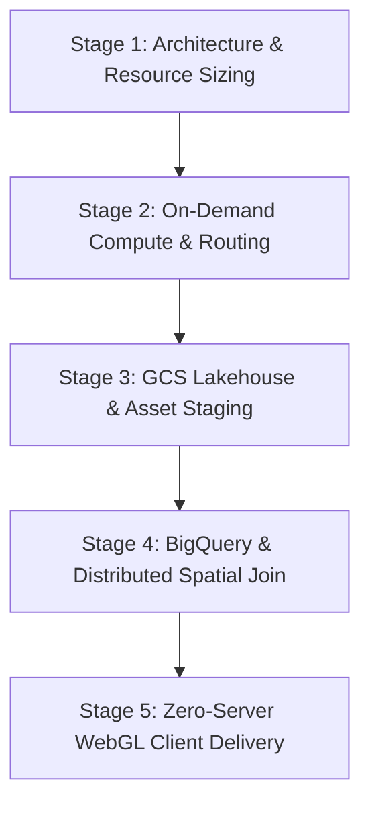
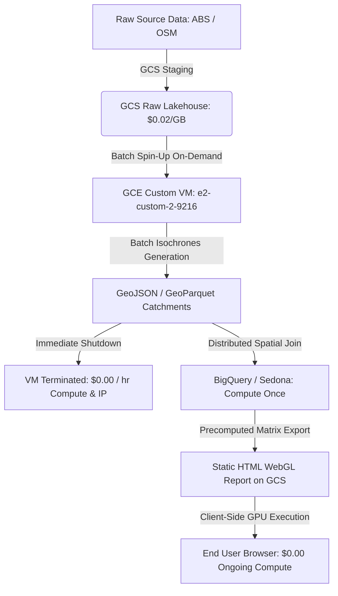

# GCP & Antigravity Playbook

## Summary

Use this playbook to architect, configure, execute, and cost-optimize cloud-native geospatial data engineering pipelines, spatial routing engines (Valhalla / OSM), lakehouse storage (Google Cloud Storage), and BigQuery spatial analytics on Google Cloud Platform (GCP) using the Antigravity AI coding assistant and Python SDKs.

---

## The Sequential Cloud Geospatial Lifecycle

To build reliable, scalable, and radically cost-effective spatial applications on GCP, follow this structured five-stage engineering lifecycle:



### Stage 1: Architecture & Resource Sizing
Before spinning up compute infrastructure, establish clear resource definitions and cost thresholds:
1. **Machine Right-Sizing**: Determine exact vCPU vs. RAM requirements. Heavy graph compilation (e.g. OpenStreetMap tile compilation) requires burst memory, whereas steady-state query inference operates efficiently on custom right-sized instances (e.g., `e2-custom-2-9216` saving >60% vs `e2-standard-4`).
2. **IP Economics & Network Planning**: Distinguish between ephemeral external IPs ($0.00 when VM is stopped) and static external IPs ($7.30/mo idle charge when VM is stopped). For batch or on-demand pipelines, use ephemeral IPs with dynamic client configuration.
3. **IAM & Least Privilege**: Configure dedicated service accounts for ingestion scripts and GCS bucket access without exposing root credentials.

### Stage 2: On-Demand Compute & Routing Daemons
Run intensive spatial routing and graph algorithms with strict lifecycle management:
1. **Self-Healing Daemons**: Deploy Valhalla, OSRM, or custom spatial microservices with `systemd` or Docker restart policies (`restart: unless-stopped`) so services automatically recover on VM reboot.
2. **On-Demand Spin-Up / Spin-Down**: Spin up VMs exclusively for the duration of spatial batch operations (e.g. 180 isochrones in ~45 seconds), and terminate them immediately upon artifact extraction to keep compute spend near $0.00.
3. **Health & Readiness Probing**: Implement lightweight `/status` probe endpoints to verify tile mounting and routing engine readiness before kicking off batch processing loops.

### Stage 3: GCS Lakehouse & Asset Staging
Establish an authoritative, auditable storage layer on Google Cloud Storage:
1. **Three-Tier Bucket Topology**: Structure data into `raw/` (immutable source polygons), `processed/` (cleaned, topologically validated GeoJSON/GeoParquet), and `deliverables/` (client-facing web apps, PMTiles, CSV crosswalks).
2. **CORS & Edge Cache Headers**: Configure CORS policies (`cors.json`) with `Access-Control-Allow-Origin: *` and deploy web assets with `Cache-Control: public, max-age=60` to guarantee instant edge propagation and zero browser caching latency on updates.
3. **Zero-Server Static Web Delivery**: Host interactive MapLibre/GeoLibre web applications directly from GCS storage buckets.

### Stage 4: BigQuery & Cloud Spatial Analytics
Execute heavy multi-polygon aggregations and demographic crosswalks:
1. **BigLake & GeoParquet Integration**: Query GCS-staged GeoParquet datasets directly from BigQuery without duplicating storage via external BigLake tables.
2. **Spatial SQL Joins**: Leverage native `ST_Intersects`, `ST_Contains`, and `ST_Centroid` functions in BigQuery / Apache Sedona (Wherobots) to produce flat reachability matrices in a single execution ("Compute Once").

### Stage 5: Zero-Server WebGL Client Delivery
1. **Client-Side GPU Offloading**: Compile spatial reports with pre-calculated distance/demographic matrices into static single-file HTML deliverables using MapLibre GL and client-side shaders.
2. **Sub-Millisecond Sliders**: Drive interactive filtering (e.g. demographic population floors, SEIFA deciles, reachability bounds) purely in client memory (<1ms response time) at **$0.00 server query cost**.

---

## Incremental Cloud Compute & Cost Optimization Principles

Managing cloud infrastructure spend while maintaining sub-second user responsiveness requires adhering to five core engineering optimization patterns:



### 1. On-Demand Compute Lifecycle (Spin Up ➔ Execute ➔ Terminate)
- **The Problem**: Leaving cloud routing instances (e.g., Valhalla running 10k+ OSM tiles) running 24/7 for occasional batch queries accumulates $70–$150/month in continuous compute charges.
- **The Best Practice**: Treat compute VMs as ephemeral workers. Script automated startup, query execution, output sync to GCS, and automatic shutdown via `gcloud compute instances stop`.

### 2. Custom VM Machine Type Right-Sizing
- **The Problem**: Standard predefined instances (e.g. `e2-standard-4` with 4 vCPU, 16 GB RAM) often over-allocate CPUs or memory, wasting 50–70% of provisioned capacity.
- **The Best Practice**: Use Google Compute Engine custom machine types (e.g. `e2-custom-2-9216` providing 2 vCPU and 9 GB RAM). This matches the exact memory working set of national routing graphs while cutting monthly costs by over 60%.

### 3. Ephemeral vs. Static IP Economics
- **The Problem**: GCP levies an hourly penalty fee ($0.010/hr ≈ $7.30/month) for unused static external IP addresses attached to stopped instances.
- **The Best Practice**: Retain ephemeral IP addressing for on-demand workers. Programmatically discover the newly assigned dynamic IP on startup (`gcloud compute instances describe --format="value(natIP)"`) and inject it into client requests, achieving **$0.00 IP cost** while instances are idle.

### 4. Decoupling Heavy Geometry Calculations from In-Browser Siting
- **The Problem**: Calculating 40-minute driving isochrones and topological polygon overlaps on-the-fly for client dashboard queries requires dedicated backend servers and introduces multi-second latency.
- **The Best Practice**: Precompute the spatial catchments and reachability graph once on GCP. Embed the resultant matrix in standalone WebGL deliverables. End users can adjust demographic sliders, minimum thresholds, and weighting criteria with sub-millisecond client recalculations at **$0.00 cloud compute cost**.

### 5. Storage Tiering & Cache-Control Metadata
- **The Problem**: Outdated browser cache policies cause stakeholders to view stale map layers or broken GeoJSON artifacts after new pipeline deployments.
- **The Best Practice**: Set fine-grained cache control metadata on GCS deployment (`--content-type="application/geo+json"` and `--cache-control="no-cache, max-age=0"` or `max-age=60`). Use Google Cloud Storage edge CDN caching for static assets while keeping data API layers instantly fresh.

---

## What This Gives You

- **Radical Cost Efficiency**: Near-zero monthly cloud run rate ($1–$3/month for persistent storage) by eliminating idle compute and IP penalties.
- **24/7 High-Availability Deliverables**: WebGL client applications served directly from GCS edge endpoints with 100% uptime, unaffected by local workstation reboots.
- **Automated Lifecycle Tooling**: 1-click CLI commands and Python SDK scripts to spin up instances, generate isochrones, and gracefully shut down.
- **Auditable Data Lineage**: Clean end-to-end data contracts from official ABS Census geometry to production GIS layers.

---

## Setup & Execution Guide

### Step 1: SDK & Cloud Driver Installation
Ensure all required Google Cloud SDKs and geospatial Python drivers are installed:
```bash
python -m pip install google-cloud-storage google-cloud-bigquery geopandas shapely requests pyyaml
```

Verify authentication with Google Cloud:
```bash
gcloud auth list
gcloud config set project <YOUR_GCP_PROJECT_ID>
```

---

### Step 2: Automated On-Demand VM Spin-Up & Dynamic IP Auto-Discovery

Use this Python / CLI automation pattern to start the routing instance, retrieve its ephemeral IP, execute spatial queries, and shut it down:

```python
import os
import subprocess
import time
import requests
import geopandas as gpd

INSTANCE_NAME = "valhalla-tuffs"
ZONE = "australia-southeast1-b"

def start_routing_instance() -> str:
    """Spins up the GCE routing VM and returns its newly assigned dynamic external IP."""
    print(f"Starting GCE instance '{INSTANCE_NAME}' in zone '{ZONE}'...")
    subprocess.run(["gcloud", "compute", "instances", "start", INSTANCE_NAME, f"--zone={ZONE}"], check=True)
    
    # Wait for network interface initialization
    time.sleep(5)
    
    # Retrieve the dynamic ephemeral IP
    cmd = [
        "gcloud", "compute", "instances", "describe", INSTANCE_NAME,
        f"--zone={ZONE}",
        '--format=value(networkInterfaces[0].accessConfigs[0].natIP)'
    ]
    ip = subprocess.check_output(cmd, text=True).strip()
    print(f"Instance active. Ephemeral external IP: {ip}")
    
    # Wait for routing daemon health probe
    base_url = f"http://{ip}:8002"
    print("Waiting for Valhalla routing daemon readiness...")
    for _ in range(30):
        try:
            r = requests.get(f"{base_url}/status", timeout=2)
            if r.status_code == 200:
                print("Valhalla routing engine is ready and serving queries.")
                return base_url
        except Exception:
            time.sleep(2)
            
    raise TimeoutError("Valhalla daemon did not respond within readiness timeout.")

def stop_routing_instance():
    """Shuts down the GCE instance to immediately halt compute charges."""
    print(f"Shutting down GCE instance '{INSTANCE_NAME}' to prevent idle compute costs...")
    subprocess.run(["gcloud", "compute", "instances", "stop", INSTANCE_NAME, f"--zone={ZONE}"], check=True)
    print("Instance terminated. Cloud compute billing is $0.00/hr.")
```

---

### Step 3: Generating Catchments & Streaming Deliverables to GCS

```python
from google.cloud import storage

def upload_deliverable_to_gcs(local_file_path: str, bucket_name: str, destination_blob: str, content_type: str = "application/json"):
    """Deploys spatial artifacts to GCS with zero-cache edge headers."""
    client = storage.Client()
    bucket = client.bucket(bucket_name)
    blob = bucket.blob(destination_blob)
    
    blob.cache_control = "public, max-age=60, must-revalidate"
    blob.content_type = content_type
    
    blob.upload_from_filename(local_file_path)
    print(f"Successfully uploaded {local_file_path} -> gs://{bucket_name}/{destination_blob}")
```

---

### Step 4: BigQuery Spatial GIS Analysis

Execute serverless spatial joins and demographic aggregations against ABS Census data:

```python
from google.cloud import bigquery

client = bigquery.Client()

query = """
SELECT 
    t.territory_id,
    t.name AS territory_name,
    COUNT(p.postcode) AS total_postcodes,
    SUM(p.males_25_64) AS total_males_25_64,
    ROUND(AVG(p.median_household_income), 2) AS avg_weekly_income,
    ST_Union_Agg(p.geom) AS territory_boundary
FROM 
    `tuffs-territory-mapping.spatial_analytics.postcode_demographics` p
JOIN 
    `tuffs-territory-mapping.spatial_analytics.territory_seeds` t
ON 
    ST_Intersects(p.geom, t.catchment_40min_geom)
GROUP BY 
    t.territory_id, t.name
ORDER BY 
    total_males_25_64 DESC;
"""

df_territories = client.query(query).to_dataframe()
print(df_territories.head(10))
```

---

## Data Verification & Cloud Health Testing

Verify cloud asset availability, storage CORS headers, and instance states using automated assertion checks:

```python
import requests
import subprocess

def verify_cloud_deployment():
    print("=" * 60)
    print(">>> RUNNING GCP & ANTIGRAVITY HEALTH VERIFICATION")
    print("=" * 60)
    
    # 1. Verify GCE Instance is Stopped (Cost Safety)
    cmd = [
        "gcloud", "compute", "instances", "list",
        "--filter=name:valhalla-tuffs",
        "--format=value(status)"
    ]
    status = subprocess.check_output(cmd, text=True).strip()
    assert status == "TERMINATED", f"Cost Safety Violation: Expected VM to be TERMINATED, but found {status}!"
    print(" PASS: Valhalla routing VM is TERMINATED (Compute cost = $0.00/hr).")
    
    # 2. Verify GCS Deliverables & HTTP Status
    endpoints = [
        "https://storage.googleapis.com/tuffs-territory-mapping/index.html",
        "https://storage.googleapis.com/tuffs-territory-mapping/project_status.html",
        "https://storage.googleapis.com/tuffs-territory-mapping/data/processed/tuffs_national_150_territories.geojson"
    ]
    
    for url in endpoints:
        resp = requests.head(url, timeout=10)
        assert resp.status_code == 200, f"Delivery Failure: Endpoint {url} returned HTTP {resp.status_code}"
        print(f" PASS: Endpoint active (HTTP 200) -> {url}")
        
    print("=" * 60)
    print(">>> ALL GCP CLOUD HEALTH CHECKS PASSED")
    print("=" * 60)

if __name__ == "__main__":
    verify_cloud_deployment()
```

---

## Key Best Practices Checklist

- [x] **Compute Right-Sizing:** Profile memory and use custom GCE instances (`e2-custom`) instead of over-provisioned standard tiers.
- [x] **Zero Idle Compute:** Always stop worker VMs when processing finishes.
- [x] **Zero Idle IP Penalty:** Use ephemeral external IPs for on-demand VMs rather than unattached static IPs.
- [x] **Client-Side WASM / WebGL:** Offload interactive filtering to user browsers via MapLibre GL and GeoLibre to eliminate backend runtime costs.
- [x] **CORS & Cache Invalidation:** Ensure GCS buckets have explicit CORS rules and short cache-control headers on GeoJSON/HTML layers.
- [x] **Continuous Cost Logging:** Track human review, AI tokens, and cloud machine hours in an auditable ledger (`TIME_AND_COST_LOG.md`).
